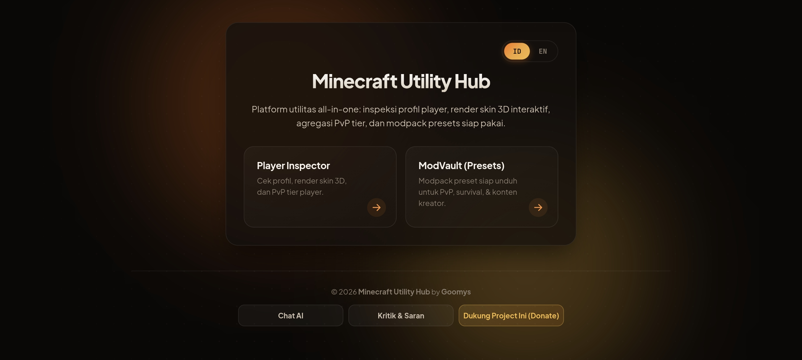
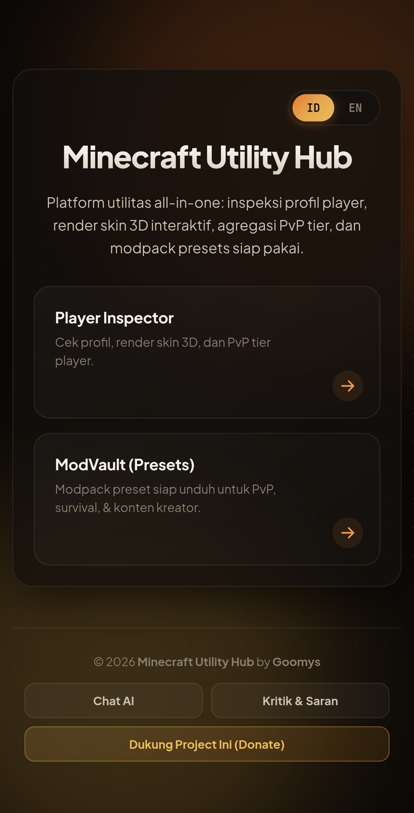

# Minecraft Utility Hub


Platform utilitas all-in-one untuk pemain Minecraft Java Edition: inspeksi profil player, render skin 3D, agregasi PvP tier, dan modpack preset siap unduh.

**Live Demo:** [minecraft-utility-hub.vercel.app](https://minecraft-utility-hub.vercel.app)

---

## Fitur

### Player Inspector
- Cek profil Minecraft Java Edition via Mojang API
- Render skin 3D interaktif (SkinView3D)
- Agregasi PvP tier dari MCTiers dan MCPVP Club
- Download skin, avatar, dan texture mentah
- Cache dengan TTL biar hemat request ke API eksternal

### ModVault
- 8 preset modpack siap pakai: FPS Boost, PvP, Survival, Builder, Content Creator, Technical, RPG, Bedwars
- Integrasi Modrinth API untuk ambil mod versi terbaru
- Support 4 mod loader: Fabric, Forge, NeoForge, Quilt
- Pencarian mod custom langsung dari Modrinth
- Download sebagai file `.zip` siap ekstrak ke folder `mods`

### Asisten Goomys
- Chatbot AI berbasis Google Gemini
- Streaming response (kata-per-kata)
- Guardrail: hanya jawab topik Minecraft Utility Hub
- Rate limit per IP
- Widget embeddable (single `<script>` tag)

### Feedback & Donasi
- Form kritik & saran, dikirim ke Discord via webhook
- Avatar Minecraft otomatis dari username
- Integrasi Saweria buat dukungan

---

## Screenshot




---

## Tech Stack

**Backend**
- Python 3.10+ & Flask 3.0
- Vercel Serverless (production)
- Google Gemini API (chat AI)
- Cloudflare Turnstile (CAPTCHA)

**Frontend**
- Vanilla HTML, CSS, JavaScript — tanpa framework
- SkinView3D (render skin 3D)
- JSZip (buat arsip modpack)
- Plus Jakarta Sans & JetBrains Mono

**API Eksternal**
- Mojang API — profil & skin
- Modrinth API — mod & versi
- MCTiers, MCPVP Club — PvP tier
- Crafatar, mc-heads.net — avatar & skin CDN

---

## Struktur Folder

```
Minecraft-Utility-Hub/
├── api/                  # Vercel serverless entrypoint
├── core/                 # Flask blueprints (app, chat, mod, player)
├── config/               # JSON: modpacks, lang, providers, icontier
├── static/               # Frontend + widget.js
├── .env.example
├── requirements.txt
├── run.py                # Local dev server
└── vercel.json
```

---

## Setup Lokal

### Prasyarat
- Python 3.10+
- pip
- Git

### Langkah

1. **Clone repo:**
   ```bash
   git clone https://github.com/geoffreyoner/Minecraft-Utility-Hub.git
   cd Minecraft-Utility-Hub
   ```

2. **Buat virtual environment:**
   ```bash
   python -m venv venv
   source venv/bin/activate        # Linux/macOS
   # venv\Scripts\activate         # Windows
   ```

3. **Install dependencies:**
   ```bash
   pip install -r requirements.txt
   ```

4. **Copy `.env.example` jadi `.env`:**
   ```bash
   cp .env.example .env
   ```

5. **Isi `.env`** — lihat tabel Environment Variables di bawah.

6. **Jalankan:**
   ```bash
   python run.py
   ```

7. Buka `http://localhost:5000`

---

## Environment Variables

| Variable | Wajib | Deskripsi |
|---|---|---|
| `PROVIDER` | Ya | Provider AI: `gemini`, `deepseek`, atau `groq` |
| `GEMINI_API_KEY` | Kalau pakai Gemini | API key dari [aistudio.google.com](https://aistudio.google.com/apikey) |
| `GEMINI_MODEL` | Tidak | Default: `gemini-2.5-flash` |
| `DEEPSEEK_API_KEY` | Kalau pakai DeepSeek | API key dari [platform.deepseek.com](https://platform.deepseek.com) |
| `GROQ_API_KEY` | Kalau pakai Groq | API key dari [console.groq.com](https://console.groq.com) |
| `CF_SECRET_KEY` | Ya (production) | Cloudflare Turnstile secret key |
| `DISCORD_WEBHOOK_URL` | Tidak | Discord webhook buat feedback |
| `PORT` | Tidak | Default: `5000` |
| `FLASK_DEBUG` | Tidak | Set `true` kalau mau debug mode |

> **Catatan:** kalau `CF_SECRET_KEY` kosong, endpoint `/api/track` dan `/api/modpack/download` bakal nolak semua request (fail-closed). Set di production biar Turnstile aktif.

---

## Deploy ke Vercel

1. Fork repo ini
2. Import ke Vercel via dashboard
3. Set environment variables di **Project Settings → Environment Variables**
4. Deploy

Setelah deploy, ganti sitekey Turnstile di `static/index.html` (2 tempat) dengan sitekey produksi lu.

---

## API Endpoints

| Method | Path | Deskripsi |
|---|---|---|
| `GET` | `/api/modpacks` | List semua preset + loader |
| `POST` | `/api/modpack/check` | Cek ketersediaan mod di Modrinth |
| `POST` | `/api/modpack/search` | Cari mod di Modrinth |
| `POST` | `/api/modpack/download` | Generate download list modpack |
| `GET` | `/api/track/<username>` | Cek profil + tier player |
| `GET` | `/api/download-skin/<uuid>` | Download skin player |
| `POST` | `/api/chat` | Chat dengan Asisten Goomys (streaming) |
| `POST` | `/api/feedback` | Kirim kritik & saran |

---

## Widget Chat Embeddable

Widget chat bisa dipasang di web lain dengan 1 tag script:

```html
<script
  src="https://minecraft-utility-hub.vercel.app/widget.js"
  data-api="https://minecraft-utility-hub.vercel.app/api/chat"
  data-title="Asisten Goomys"
  data-greeting="Selamat datang. Silakan tanya soal fitur website."
></script>
```

Panggil manual via `window.MUHChat.open()`.

---

## Kontribusi

Pull request selalu diterima. Untuk perubahan besar, buka issue dulu biar bisa didiskusikan.

1. Fork repo
2. Buat branch: `git checkout -b fitur/nama-fitur`
3. Commit: `git commit -m "Add: fitur baru"`
4. Push: `git push origin fitur/nama-fitur`
5. Buka Pull Request

---

## Kredit

- **Developer:** [Goomys](https://github.com/geoffreyoner)
- **Skin rendering:** [skinview3d](https://github.com/bs-community/skinview3d)
- **Mod data:** [Modrinth](https://modrinth.com)
- **Avatar CDN:** [Crafatar](https://crafatar.com), [mc-heads.net](https://mc-heads.net)
- **PvP tiers:** [MCTiers](https://mctiers.com), [MCPVP Club](https://mcpvp.club)

---

## License

[MIT](LICENSE) © 2026 Goomys

---

## Dukungan

Kalau project ini berguna, lu bisa traktir kopi di [Saweria](https://saweria.co/Bayyyyqt).